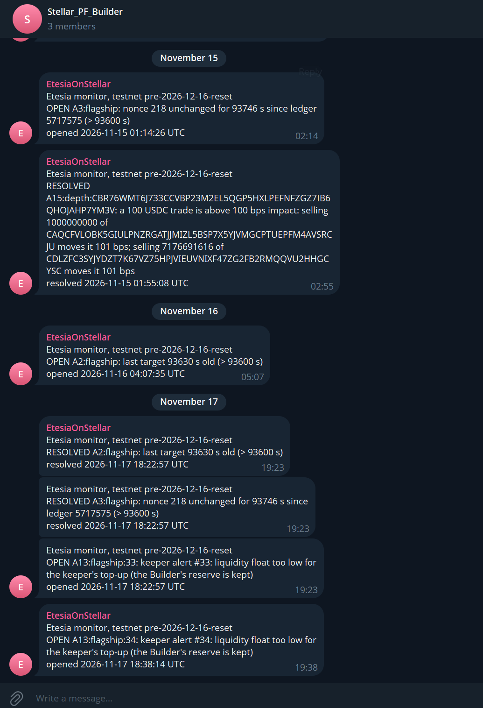

# Etesia vault

[](#build-and-test)

This repository holds the Etesia vault contracts for Soroban. The vault takes USDC deposits and is also its own SEP-41 share token.
It executes keeper rebalance plans through Soroswap Aggregator v3 under onchain guardrails, supplies idle USDC to a Blend v2 pool and prices its holdings through Reflector.
For Tranche 2 (Testnet) of the Application Build Award, it runs on Stellar testnet.

[App (testnet)](https://portfolioatelier.etesiar.com/?network=testnet) · [Vault on Stellar Expert](https://stellar.expert/explorer/testnet/contract/CD73M44EYNZOX7YWPSBMITVPERWNA6ZHDLAZ2XSM4RQM6V4XT7GYXFQH) · [Portfolio Builder code](https://github.com/Etesia-Research/etesia-portfolio-builder)

## Tranche 2: where to verify each measure

Each row quotes the award measure. Evidence links open this repository, the Portfolio Builder repository or the hosted app; onchain links open Stellar Expert (testnet).

### Deliverable 4: Soroswap Swap Execution + Blend v2 Yield on Testnet

| Measure | Evidence | Onchain |
| --- | --- | --- |
| 1. End-to-end rebalances executed on Stellar testnet through Soroswap and verifiable on-chain | [Reconciliation of 18 consecutive rebalances](docs/evidence/t2-index.md#t2-d4-10-reconciliation)<br>[Execution code](contracts/vault/src/execution.rs) | [fbea98ae](https://stellar.expert/explorer/testnet/tx/fbea98ae6856838d359b90bdaacc6f7e7c5542561a5ef8797ca45637aaa69ad7) target published<br>[9ca779f1](https://stellar.expert/explorer/testnet/tx/9ca779f1ea97dd6f0bbee629288a32f606eda76a1711c938d297a905ef893812) 17.21 USDC to 112.93 XLM |
| 2. Drift and signal triggers fire correctly under simulated market moves | [Decision record with the triggers that fired](docs/evidence/t2-d4-07-scheduled-decision-2026-11-12.json)<br>[Trigger rules](docs/tranche-2/tranche-2-quant-code-overview.md#4-triggers-d4-07) and [trigger tests](docs/tranche-2/tranche-2-quant-code-overview.md#12-test-suite) | [Keeper account](https://stellar.expert/explorer/testnet/account/GDGCL46KVU6FR2BU32PUGS7KBQCE6U4375JCR7NHU3PMX5K3O7VXJT7N) rebalance history |
| 3. Idle stablecoins deposited into a Blend v2 testnet pool; yield accrual reflected in vault NAV | [NAV read: Blend interest in total assets](docs/tranche-2/evidence/d4-08-nav-read-2026-11-14.md)<br>[Blend client](contracts/vault/src/blend.rs) | [aa8f8e19](https://stellar.expert/explorer/testnet/tx/aa8f8e1938be1311db3fc3004f9c6ace82f745f42beb1edd4780a777a739b4c8) supply 94.98 USDC<br>[8e6056c7](https://stellar.expert/explorer/testnet/tx/8e6056c7beb50e0659d9b04f71a2d8d3e4562ae5d291fc0c3fbdce6cbc255c7d) withdrawal on re-entry |
| 4. Plans violating vault guardrails are rejected on-chain | [13 rejected plans on the guard vault](docs/evidence/d4-09-guard-pre-2026-12-16-reset.jsonl) (the steps with `tx.status` `FAILED`)<br>[Guardrail checks](contracts/vault/src/execution.rs) | [2349d9b2](https://stellar.expert/explorer/testnet/tx/2349d9b2367466048636e5a07386e9ec25f04c6f6a94777cc60bf3ab3a1ae093) rejected for slippage<br>[Guard vault](https://stellar.expert/explorer/testnet/contract/CCUHQJ3FSGC26UOCLN3EK2DUO725ZLBVRUF5B7N36W6MB3DM4JEOC6VO) |

### Deliverable 5: Portfolio Builder Tool & Stellar Wallets Kit

| Measure | Evidence | Onchain |
| --- | --- | --- |
| 1. End-to-end testnet flow from Stellar Wallets Kit connection to allocation, deposit and withdrawal | [Portfolio Builder (testnet)](https://portfolioatelier.etesiar.com/?network=testnet)<br>[Portfolio Builder code](https://github.com/Etesia-Research/etesia-portfolio-builder) | [e48eeda4](https://stellar.expert/explorer/testnet/tx/e48eeda45a153b475f15f95c7d8787928e7aaa22dc43b6fc8ffd76cea43ee016) vault deposit<br>[c20b6c0b](https://stellar.expert/explorer/testnet/tx/c20b6c0bb3a2008d50882163b85959744f891a91f3b54a32200f50b6da159c3d) automatic trustline<br>[9af5108b](https://stellar.expert/explorer/testnet/tx/9af5108b89eead7a72f0b534da4795c91c334e8801745480bc4915f3beeb3d2a) withdrawal |
| 2. Indexed metrics displayed in the dashboard with sub-second retrieval for standard views | [Vault page](https://portfolioatelier.etesiar.com/stellar_tf_vault/testnet)<br>[Latency of the six standard views](docs/tranche-2/evidence/d5-05-latency-2026-11-12.md) | — |
| 3. Rebalance events and Blend yield reflected in the UI from indexed data | [Vault page](https://portfolioatelier.etesiar.com/stellar_tf_vault/testnet)<br>[Indexed events](https://portfolioatelier.etesiar.com/api/quant/vaults/flagship/events?limit=100) | — |

### Deliverable 6: Stress Testing, Monitoring & Mainnet Readiness

| Measure | Evidence | Onchain |
| --- | --- | --- |
| 1. Stress scenarios executed with documented results; invalid executions rejected on-chain | [Stress matrix](docs/tranche-2/d6-01-stress-matrix.md)<br>[13 rejected plans (Deliverable 4, measure 4)](docs/evidence/d4-09-guard-pre-2026-12-16-reset.jsonl) | [4c55ed60](https://stellar.expert/explorer/testnet/tx/4c55ed60dc50e7eaf29d6a0cd9bfe47d2aaf085e8eb641a236826103637c37bf) unfilled swap reverted<br>[05eb51e9](https://stellar.expert/explorer/testnet/tx/05eb51e981b1741e5eb35fc5d2fda004a9f18931c27a4dc1fa344c55857a507b) withdrawal, keeper and indexer stopped |
| 2. Monitoring and alerting operational for all testnet vaults | [Alerts with open and resolve times](docs/tranche-2/d6-03-alert-evidence.md) | — |
| 3. Mainnet deployment checklist completed and reviewed | [Mainnet readiness checklist](docs/tranche-2/d6-05-mainnet-readiness-checklist.md) | — |

The monitor posts each alert to a Telegram chat once when it opens and once when it resolves:



Also delivered: the [operations runbook](docs/operations.md), the [runbook drills](docs/tranche-2/d6-04-runbook-drills.md) and the [limits calibration](docs/tranche-2/d6-02-limits-v1.md) (rebalance thresholds, slippage caps and concentration limits).

## Transaction archive

Stellar testnet resets on 16 December 2026. Every transaction cited above is archived here with its envelope, result and meta XDR.

To read one:

1. Search [docs/evidence/t2-index.md](docs/evidence/t2-index.md) for the hash. The failed swap and the 13 guard rejections are in the files named under "Archived elsewhere".
2. Open the JSON file named in that section's heading and find the entry with that hash.
3. Decode a field with `stellar xdr decode --type TransactionEnvelope --output json-formatted <base64>` (`TransactionResult` and `TransactionMeta` for the others), or paste it into the [Stellar Lab XDR viewer](https://lab.stellar.org/xdr/view).

## Testnet deployment

| Component | Id |
| --- | --- |
| Flagship vault (ETESIA-TF in the app), also the share token | [CD73M44EYNZOX7YWPSBMITVPERWNA6ZHDLAZ2XSM4RQM6V4XT7GYXFQH](https://stellar.expert/explorer/testnet/contract/CD73M44EYNZOX7YWPSBMITVPERWNA6ZHDLAZ2XSM4RQM6V4XT7GYXFQH) |
| Guard vault, tight limits for the guardrail tests | [CCUHQJ3FSGC26UOCLN3EK2DUO725ZLBVRUF5B7N36W6MB3DM4JEOC6VO](https://stellar.expert/explorer/testnet/contract/CCUHQJ3FSGC26UOCLN3EK2DUO725ZLBVRUF5B7N36W6MB3DM4JEOC6VO) |
| Keeper account (flagship executor) | [GDGCL46KVU6FR2BU32PUGS7KBQCE6U4375JCR7NHU3PMX5K3O7VXJT7N](https://stellar.expert/explorer/testnet/account/GDGCL46KVU6FR2BU32PUGS7KBQCE6U4375JCR7NHU3PMX5K3O7VXJT7N) |
| Etesia pricing provider, reads Reflector | [CC3ASLC6FIH76EVTMJIC2IAMVUS5Y5JYXI4WM4U5RPEUBPUGCWWSX5EB](https://stellar.expert/explorer/testnet/contract/CC3ASLC6FIH76EVTMJIC2IAMVUS5Y5JYXI4WM4U5RPEUBPUGCWWSX5EB) |
| Soroswap Aggregator v3, Etesia-deployed copy | [CBE32GUTQH657PTGU2ILOCY44QCOYTKKVMFW5TWFPTBZYSIMTZVUV5TH](https://stellar.expert/explorer/testnet/contract/CBE32GUTQH657PTGU2ILOCY44QCOYTKKVMFW5TWFPTBZYSIMTZVUV5TH) |
| Blend v2 pool | [CCEBVDYM32YNYCVNRXQKDFFPISJJCV557CDZEIRBEE4NCV4KHPQ44HGF](https://stellar.expert/explorer/testnet/contract/CCEBVDYM32YNYCVNRXQKDFFPISJJCV557CDZEIRBEE4NCV4KHPQ44HGF) |
| USDC (Blend testnet USDC) | [CAQCFVLOBK5GIULPNZRGATJJMIZL5BSP7X5YJVMGCPTUEPFM4AVSRCJU](https://stellar.expert/explorer/testnet/contract/CAQCFVLOBK5GIULPNZRGATJJMIZL5BSP7X5YJVMGCPTUEPFM4AVSRCJU) |
| tRESERVE, testnet stand-in for USTRY | [CCOF6WEYQQUFIMR4SEVELW4AGZAOYMGZCYCQVXN7AFGWZXXVEDPXQ5K7](https://stellar.expert/explorer/testnet/contract/CCOF6WEYQQUFIMR4SEVELW4AGZAOYMGZCYCQVXN7AFGWZXXVEDPXQ5K7) |

All ids, roles, limits and code hashes are in the [deployment manifest](deploy/testnet/pre-2026-12-16-reset.json).

### Deployed code

Both vaults run WASM `ac188cbf790c3fa3a4112fb4f2abe0dfd587303936e2c132f2df9eb062d41b47`, and the pricing provider runs `3070b68c3ec31a8f200646c42a3305d92ff42ed83785d234572457c03733201c`.
Building commit [`5807b85`](https://github.com/Etesia-Research/stellar_vault/tree/5807b8535ed26224e7e6155ac65a6e4581d81752) with `stellar contract build --locked --optimize` (Stellar CLI 28.1.0, Rust 1.99.1) reproduces both byte for byte.

`master` adds one rule after that commit, the yield-limit tolerance ([`7e4934c`](https://github.com/Etesia-Research/stellar_vault/commit/7e4934c7dc8d2755a9c603247c4d3bbb08779e06), described in the [mainnet readiness checklist](docs/tranche-2/d6-05-mainnet-readiness-checklist.md#platform)).
Release [v0.1.0](https://github.com/Etesia-Research/stellar_vault/releases/tag/v0.1.0) is built from `master`.

## Asset universe

The strategy trades XLM, AQUA, ETH and BTC, with USTRY as the reserve and USDC for settlement.
The Tranche 2 testnet vaults hold XLM, USDC and tRESERVE, Etesia's testnet stand-in for USTRY.
They keep the strategy's XLM weight and split the rest between tRESERVE and USDC ([testnet mapping](docs/tranche-2/tranche-2-quant-code-overview.md#3-strategy-decision-and-target-builder-d1-d4-04)).

Mainnet routing and liquidity for each asset are measured in the [limits calibration](docs/tranche-2/d6-02-limits-v1.md#finding-2-mainnet-soroswap-liquidity-covers-only-xlm-and-ustry) and tracked in the [mainnet readiness checklist](docs/tranche-2/d6-05-mainnet-readiness-checklist.md#findings-from-d6-02).

## Related code

| Code | Where |
| --- | --- |
| Portfolio Builder: frontend and vault page | [Etesia-Research/etesia-portfolio-builder](https://github.com/Etesia-Research/etesia-portfolio-builder) |
| Keeper, indexer, metrics API and monitor | Private repository, open to reviewers on request. [Overview](docs/tranche-2/tranche-2-quant-code-overview.md) |

## Repository map

| Path | What it holds |
| --- | --- |
| [contracts/vault](contracts/vault) | The vault and share token: deposit and withdraw (`lib.rs`), plans and guardrails (`execution.rs`), Blend v2 (`blend.rs`), valuation (`pricing.rs`), pause and timelock (`governance.rs`), fees (`fees.rs`) |
| [contracts/pricing](contracts/pricing) | Pricing provider that reads Reflector feeds |
| [contracts/adapter](contracts/adapter) | DeFindex strategy adapter that mirrors the DeFindex strategy trait |
| [deploy/testnet](deploy/testnet) | Testnet deployment manifest |
| [docs/tranche-2/](docs/tranche-2/) | Tranche 2 records: stress matrix, limits calibration, alerts, runbook drills, mainnet checklist, NAV and latency evidence, quant code overview |
| [docs/evidence/](docs/evidence/) | Transaction archive and its index, rebalance reconciliation, guard rejections, limits measurements, Tranche 1 records |
| [docs/](docs/) | [Interfaces](docs/interfaces.md), [operations](docs/operations.md), [pricing](docs/pricing.md), Tranche 1 acceptance records ([vault](docs/acceptance.md), [pricing](docs/d3-acceptance.md)), [local network reproduction](docs/local-rpc.md) |
| [scripts/](scripts/) | Checks, WASM fetch, local node, testnet deployment and evidence recording |
| [tools/](tools/) | Local test fixtures and a read-only network probe |
| [vendor/defindex](vendor/defindex) | Pinned DeFindex source, built as the parent vault for the adapter tests |

## Build and test

Pinned versions: Rust 1.99.1 ([rust-toolchain.toml](rust-toolchain.toml)), soroban-sdk and soroban-token-sdk 29.0.1 ([Cargo.toml](Cargo.toml)), Stellar CLI 28.1.0 and cargo-llvm-cov 0.9.1 ([docs/local-rpc.md](docs/local-rpc.md)).
Rust 1.84.1 with the `wasm32-unknown-unknown` target builds the vendored DeFindex vault for the adapter tests.

```sh
. scripts/env.sh   # optional: repository-local tools
rustup toolchain install 1.84.1 --profile minimal -t wasm32-unknown-unknown
cargo install cargo-llvm-cov --version 0.9.1 --locked
MAINNET_RPC_URL=<mainnet RPC URL> sh scripts/fetch-wasm.sh   # Soroswap WASMs used by the tests
sh scripts/check.sh
```

The check runs format, clippy, the tests and the optimized build, enforces a 90% minimum production line coverage and refreshes the badge.
On `master` it passes 68 tests: 53 for the vault (6 against the real Soroswap WASMs), 12 for the pricing provider and 3 for the adapter.
Production line coverage is 95.31% (1,911 of 2,005 lines).

To run the contracts on a local network, see [docs/local-rpc.md](docs/local-rpc.md).

## License

Copyright (c) 2026 Etesia Research Inc. Etesia-owned materials are available for inspection under the [Proprietary Source Inspection License](LICENSE).
Running, building, testing, modifying, distributing or deploying them requires prior written authorization and a separate signed agreement.
Vendored DeFindex code keeps its [GPL-3.0 license](vendor/defindex/LICENSE), and other dependencies keep their own licenses.
